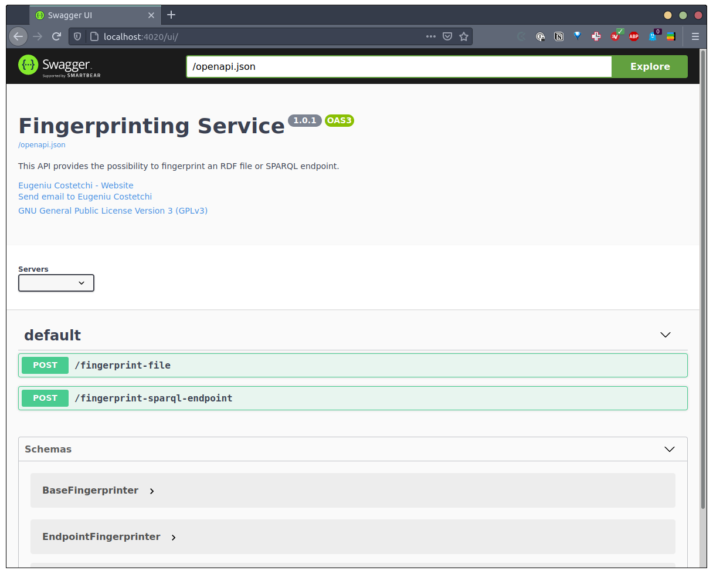
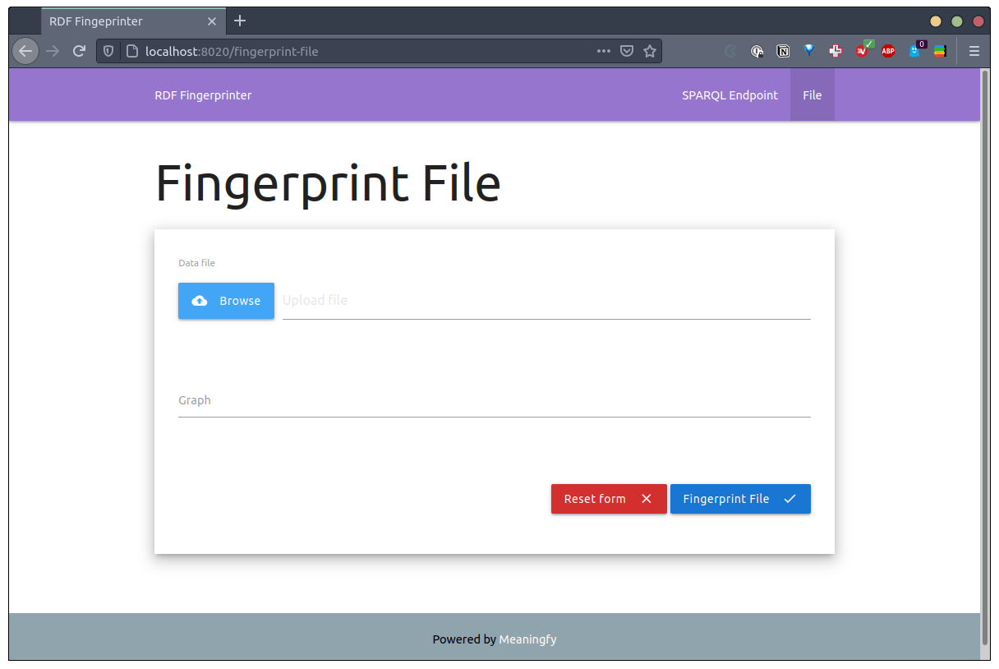
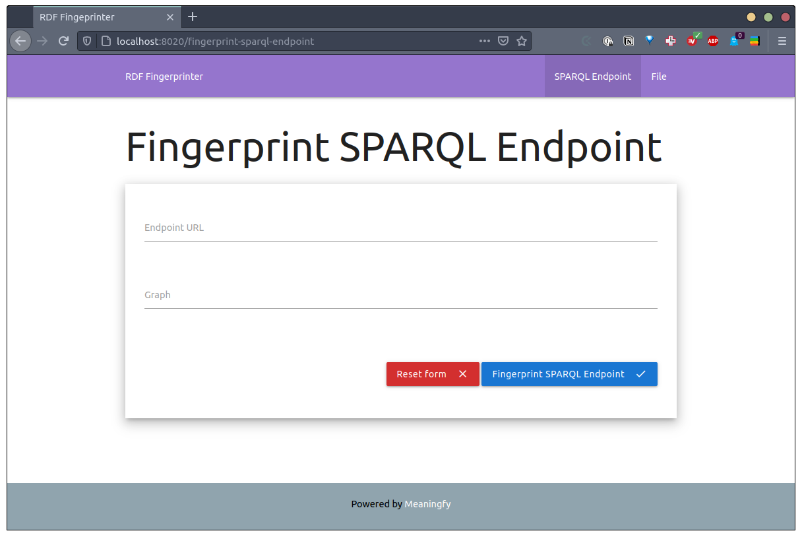
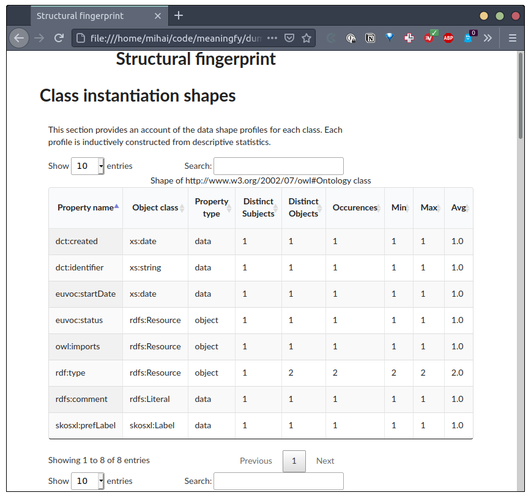

#  RDF Fingerprinter
This service provides the possibility to fingerprint an RDF file or SPARQL endpoint.

Contents
--------
* [API Reference](srcdocs/modules)

# Installation
Requires [uv](https://docs.astral.sh/uv/) (Python 3.13 is fetched by uv) and Docker for the services.

```bash
make install      # uv sync: the service and its development tools
make check-all    # lint, type check, architecture, spec and the tests
```

The services (API, UI, Celery worker, Flower, Redis, Fuseki) run with Docker; see **Usage** below.
They read their settings from `docker/.env`.

### [this file](curl-examples.md) contains a list of examples on how to use the updated api


# Usage

## Start services
To run the docker containers for the `rdf-fingerprinter` `api` and `ui`, and `fuseki`:

```bash
make start-services
```

The diffing services are split into:

service | URL | info
------- | ------- | ----
`fingerprinter-api` | [localhost:4020](http://localhost:4020) | _access [localhost:4020/ui](http://localhost:4020/ui) for the swagger interface_ 
`fingerprinter-ui` | [localhost:8020](http://localhost:8020) |

## Fingerprinter API

> Go to this link [localhost:4020/ui](http://localhost:4020/ui) to access the online definition of the API.



## Fingerprinter UI

> To fingerprint a file access [http://localhost:8020/fingerprint-file](http://localhost:8020/fingerprint-file)




> To fingerprint a file access [http://localhost:8020/fingerprint-sparql-endpoint](http://localhost:8020/fingerprint-sparql-endpoint)



### Report example



## Stop services
To stop the containers run:
```bash
make stop-services
```

# Contributing
You are more than welcome to help expand and mature this project. We adhere to [Apache code of conduct](https://www.apache.org/foundation/policies/conduct), please follow it in all your interactions on the project.   

When contributing to this repository, please first discuss the change you wish to make via issue, email, or any other method with the maintainers of this repository before making a change.

## Licence 
This project is licensed under [GNU GPLv3](https://www.gnu.org/licenses/gpl-3.0.en.html) licence. 

Powered by [Meaningfy](https://github.com/meaningfy-ws).