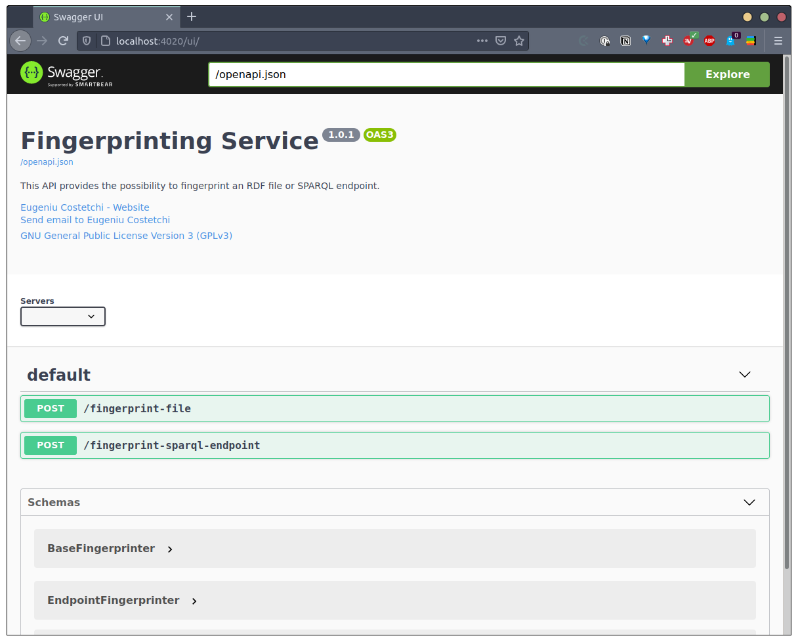
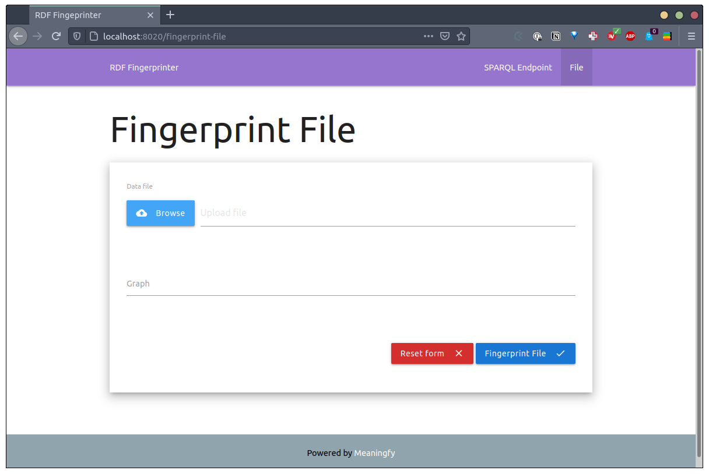
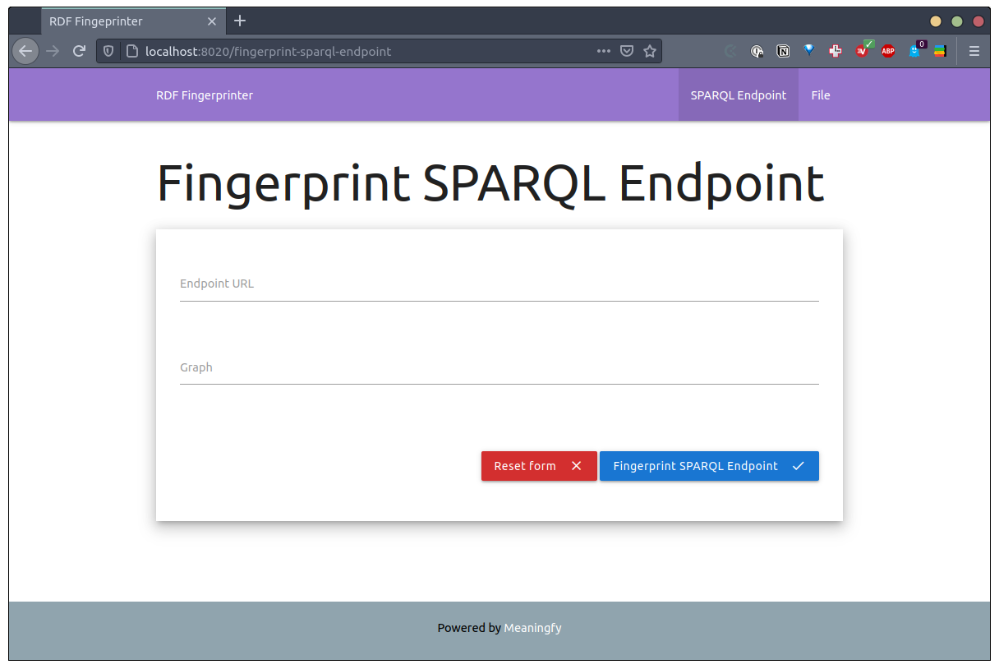
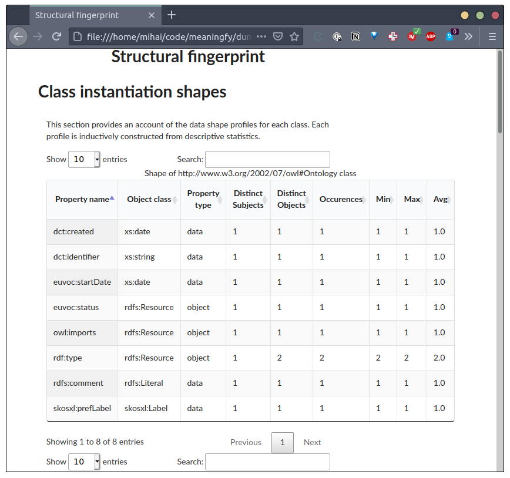

#  RDF Fingerprinter
This service provides the possibility to fingerprint an RDF file or SPARQL endpoint.

Contents
--------
* [API Reference](srcdocs/modules)

# Installation
> NOTE: The specified installation instruction are for development purposes only. (Slight modifications are required for production use; including having a production level Fuseki server and Redis service available.)

You may proceed with the following steps, but you are also able to develop
using the docker services, if you are so inclined (e.g. if installing
third-party software other than docker looks less appealing) as outlined
in **Usage** further below.

For Red Hat systems, make sure that the EPEL (Extra Packages for Enterprise Linux) repository is enabled added to the server's package lists. This is usually installed by running:
```bash 
sudo yum install epel-release
```

In order to for the fingerprinter to work correctly you need to have a fuseki server running, and update these values in the `bash/.env` file
```
RDF_FINGERPRINTER_FUSEKI_LOCATION=
RDF_FINGERPRINTER_FUSEKI_PORT=
RDF_FINGERPRINTER_FUSEKI_USERNAME=
RDF_FINGERPRINTER_FUSEKI_PASSWORD=
```
Run the following commands to install all required dependencies on a **redhat** system (see the Makefile or tab-complete for other platforms)

```bash
make install-os-dependencies-redhat
make install-python-dependencies-redhat
```

To set up redis server:
```bash
make run-local-redis-redhat
```

Run api and celery:
```bash
make run-local-api
```

Run ui:
```bash
make run-local-ui
```

Stop api and ui servers:
```bash
make stop-local-gunicorn
```

If you are running the project for the first time this would be the commands run:
```bash
make install-os-dependencies-redhat
make install-python-dependencies-redhat
make run-local-redis-redhat
make run-local-api
make run-local-ui
```

### [this file](curl-examples.md) contains a list of examples on how to use the updated api


# Usage

## Start services
To run the docker containers for the `rdf-fingerprinter` `api` and `ui`, and `fuseki`:

```bash
make start-services
```

The diffing services are split into:

service | URL | info
------- | ------- | ----
`fingerprinter-api` | [localhost:4020](http://localhost:4020) | _access [localhost:4020/ui](http://localhost:4020/ui) for the swagger interface_ 
`fingerprinter-ui` | [localhost:8020](http://localhost:8020) |

## Fingerprinter API

> Go to this link [localhost:4020/ui](http://localhost:4020/ui) to access the online definition of the API.



## Fingerprinter UI

> To fingerprint a file access [http://localhost:8020/fingerprint-file](http://localhost:8020/fingerprint-file)




> To fingerprint a file access [http://localhost:8020/fingerprint-sparql-endpoint](http://localhost:8020/fingerprint-sparql-endpoint)



### Report example



## Stop services
To stop the containers run:
```bash
make stop-services
```

# Contributing
You are more than welcome to help expand and mature this project. We adhere to [Apache code of conduct](https://www.apache.org/foundation/policies/conduct), please follow it in all your interactions on the project.   

When contributing to this repository, please first discuss the change you wish to make via issue, email, or any other method with the maintainers of this repository before making a change.

## Licence 
This project is licensed under [GNU GPLv3](https://www.gnu.org/licenses/gpl-3.0.en.html) licence. 

Powered by [Meaningfy](https://github.com/meaningfy-ws).